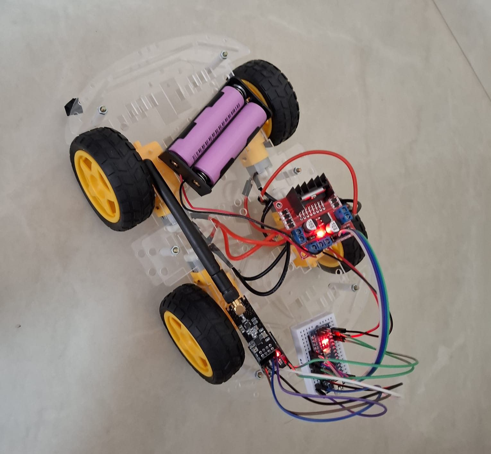
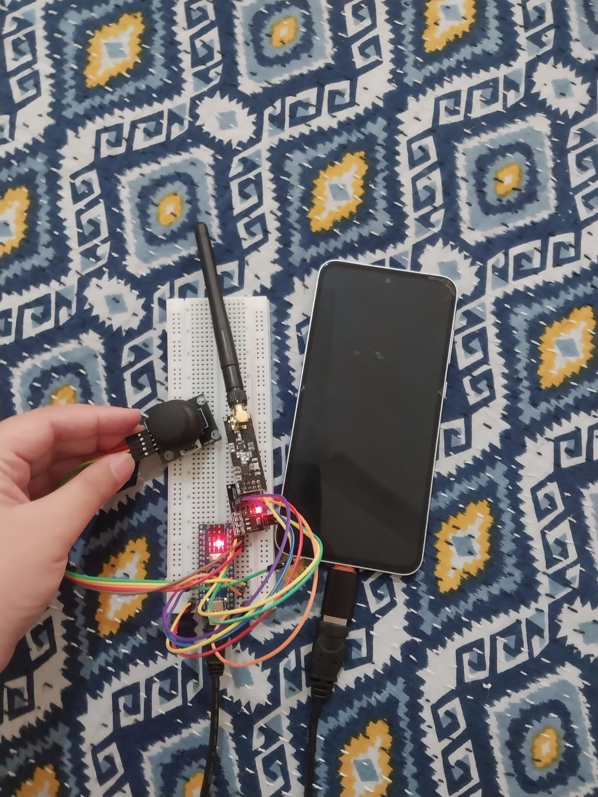

# NRF24 RC Car

A 4-wheel RC car I built while learning Arduino and embedded systems. A joystick remote reads the stick position and sends it over a 2.4 GHz NRF24L01 radio link. A receiver on the car turns those values into drive and turn commands through an L298N motor driver.

**Demo video:** [Watch it drive]

https://github.com/user-attachments/assets/ab6cf226-5e21-4eaf-ad74-6edbbde4c8ab

## Hardware

| Part | Qty | Used for |
|---|---|---|
| Arduino Nano | 2 | One in the car (receiver), one in the remote (transmitter) |
| NRF24L01 (external antenna version) with adapter board | 2 | Wireless link |
| L298N motor driver | 1 | Drives the left and right motors |
| DC gear motors with wheels | 4 | Two on each side, wired in parallel per side |
| Joystick module | 1 | Remote control input |
| 18650 cells in a 2-cell holder | 2 | Car battery |
| Acrylic 4-wheel chassis, breadboards, jumper wires | | Frame and wiring |

## How it works

1. **Remote (`remote.ino`):** reads the joystick X and Y axes (0–1023 each) about 20 times a second and sends them as a two-value packet.
2. **Car (`rc_car1_code.ino`):** receives each packet and compares the values to thresholds around the joystick centre (400 to 600).
   - Stick forward or back drives all wheels forward or in reverse.
   - Stick left or right turns the car by running the left and right wheels in opposite directions.
   - Stick near the centre stops the motors.

## Wiring

The NRF24 modules sit on adapter boards with an onboard voltage regulator, so they are powered from the Nano's 5V pin.

**Car (receiver Nano)**

| Connection | Nano pin |
|---|---|
| NRF24 CE | D7 |
| NRF24 CSN | D8 |
| NRF24 SCK / MOSI / MISO | D13 / D11 / D12 |
| NRF24 VCC / GND | 5V / GND |
| L298N IN1, IN2 (left motors) | D2, D3 |
| L298N IN3, IN4 (right motors) | D4, D5 |

- Left motors connect to the L298N OUT1/OUT2 terminals and right motors to OUT3/OUT4.
- The ENA/ENB jumpers are in place, so the motors run at full speed.
- The Nano's GND and the L298N's GND are connected together.
- Motor power comes from the 18650 holder into the L298N power input.

**Remote (transmitter Nano)**

| Connection | Nano pin |
|---|---|
| NRF24 CE / CSN | D7 / D8 |
| NRF24 SCK / MOSI / MISO | D13 / D11 / D12 |
| NRF24 VCC / GND | 5V / GND |
| Joystick X axis | A0 |
| Joystick Y axis | A1 |
| Joystick power | 5V / GND |

 The Nano is powered through its USB port from my phone, so the remote works without a laptop.

## Problems I ran into

- **Inverted motors.** The motors spun the opposite way from what I expected. I fixed it in software by reversing the HIGH/LOW pin states for each direction instead of rewiring, and the left/right turn commands needed swapping too. These lines are marked `INVERTED` in the code.
- **Wires not fitting the L298N terminals.** The motor wires would not go into the screw terminals properly, so I trimmed them until they could be clamped securely under the screws.
